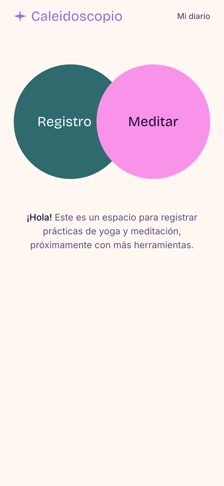
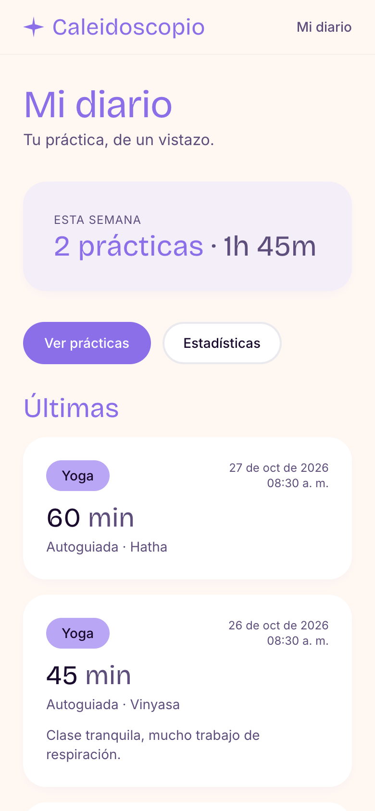
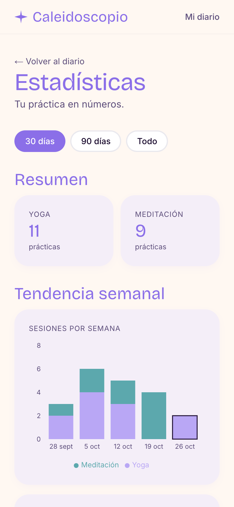
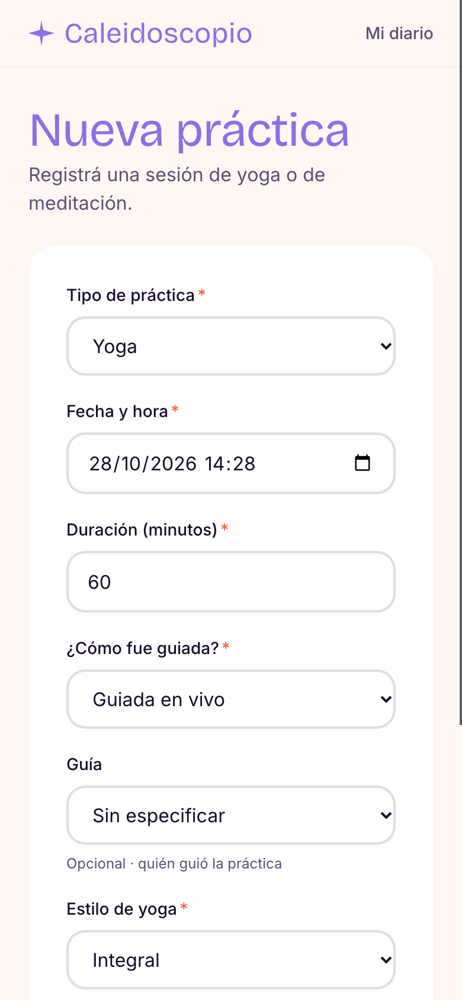
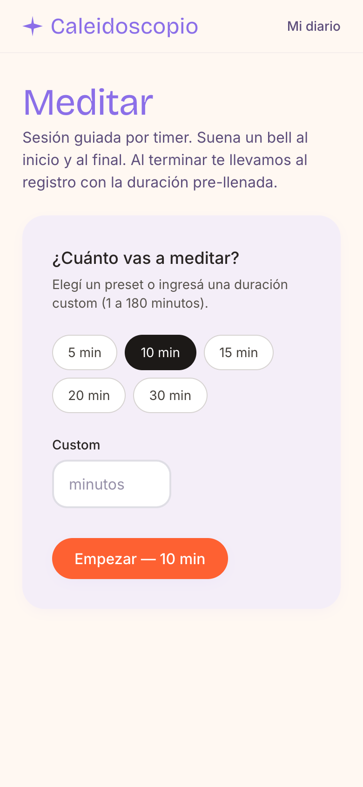

# Caleidoscopio

A mobile-first diary for yoga and meditation practices. I'm a yoga teacher and computer engineer. I built it to log my own practice and to experiment with Claude Code, mostly during May 2026.

**Live demo**: [caleidoscopio-yoga.vercel.app](https://caleidoscopio-yoga.vercel.app). It runs on a separate database seeded with fictional practices, so feel free to click around (and add or delete entries).

> **Status:** paused, not finished. I'm focusing on other side projects for now. Open issues list what's pending (exercise catalog, PWA, auth).

## Screenshots

<table>
  <tr>
    <td></td>
    <td></td>
    <td></td>
  </tr>
  <tr>
    <td></td>
    <td></td>
    <td></td>
  </tr>
</table>

## How this was built

This was my first vibe-coded project.

The split, as honestly as I can put it:

- **Me**: the product. What to build and why, based on my own daily use, plus the visual direction and what to cut. For the stack and the data model, the agent laid out options and I mostly went with its recommendations. I reviewed every change, handled the git/PR workflow, set up deploys on Vercel and Neon, and typed the smaller code changes myself. I had big ideas for the visual design that ended up being more like the horse drawing meme. I stopped fighting at some point and settled for a fairly basic style.
- **The AI agent**: most of the code (new files, larger features, tests) and the recommendations behind the technical choices.

Some commits carry a `Co-Authored-By: Claude` trailer, but most don't, so the git history understates how much of the code was AI-written. This section is the accurate version.

What I take away from it:

- **The PR workflow**: a branch per change, going back and forth on it with git, and CI on every PR. That's what made it possible to review AI-written code properly.
- **Working with an AI coding agent**: giving it context, reviewing what it writes, and keeping changes small enough to follow. That last part was the most challenging, and one of the best lessons of the project.
- **Daily use beats ideas on paper (my wandering mind)**: several things I thought would be useful turned out not to be in practice. Pre/post mood tracking, for example, was cute but too rigid for the yoga/meditation context, so I removed it.

## Stack

- **Next.js 16** (App Router) + strict **TypeScript**
- **Tailwind CSS** for styling, **Recharts** for stats
- **Prisma** + **Postgres** (Neon, with separate branches for dev, demo and personal data)
- **Zod** for validation with discriminated unions
- **Vitest** (unit) + **Playwright** (E2E)
- **ESLint** + **Prettier**
- **GitHub Actions** for CI, **Vercel** for deploys

## Features

- Log yoga and meditation practices: duration, guidance (live / recorded / self-guided), teacher, notes
- Yoga styles and teachers grow with use: new ones are saved as you log them and offered next time
- Meditation with multiple focus objects and position
- Diary landing with a weekly summary, a full practice list, and a stats page (weekly trends, style and focus distributions)
- Meditation timer with synthesized bell that pre-fills the log entry when it ends

## Setup

Requires Node 24+ and a Postgres database. The fastest path is a free [Neon](https://neon.tech) project.

```bash
git clone https://github.com/arambarrid/yoga-diary.git
cd yoga-diary
npm install
cp .env.example .env
# edit .env: set DATABASE_URL (pooled) and DIRECT_URL (direct) from your Neon dashboard
npx prisma migrate dev      # applies migrations to your database
npm run dev
```

Open [http://localhost:3000](http://localhost:3000).

To fill a database with fictional demo data, put its direct URL in `.env.demo` as `DEMO_DATABASE_URL` and run `node --env-file=.env.demo prisma/seed-demo.mts --reset`.

## Scripts

| Command              | What it does                                  |
| -------------------- | --------------------------------------------- |
| `npm run dev`        | Start the dev server                          |
| `npm run build`      | Apply migrations + production build           |
| `npm run lint`       | ESLint                                        |
| `npm run typecheck`  | `tsc --noEmit`                                |
| `npm run format`     | Format with Prettier                          |
| `npm test`           | Unit tests (Vitest, watch mode)               |
| `npm test -- --run`  | Unit tests in CI mode                         |
| `npm run test:e2e`   | E2E tests (Playwright, starts the dev server) |
| `npm run db:migrate` | Create/apply Prisma migrations                |
| `npm run db:studio`  | Open Prisma Studio                            |

## Domain model

A single `Practice` entity with a `type` field (`yoga` \| `meditation`) and optional columns depending on the type. Validation via `z.discriminatedUnion` in `src/lib/schemas.ts`.

**Shared fields**: `date`, `durationMin`, `guidance` (live / recorded / self), `teacher`, `notes`.

**Yoga-specific**: `yogaStyle` (integral, vinyasa, hatha, ashtanga, yin, restorative, other) + `yogaStyleCustom` when the style is "other".

**Meditation-specific**: `focusObjects[]` (breath, mantra, body_scan, sound, visualization, other), `position` (bed, chair, zafu, floor, cushion, other).

## Technical decisions

- **Unified model** instead of separate entities: simplifies the diary listing (one query, one table, one base UI) and stats queries.
- **Postgres via Neon** for dev and production: serverless, free tier, and database branching per environment. The public demo runs on its own branch, so my personal records never reach the public site.
- **Strict TypeScript** with `noUncheckedIndexedAccess`.
- **PR workflow** even as a solo project: each feature on its own branch, PR against `main`, CI runs lint, typecheck, unit, build and E2E, squash-merge.
- **Hero pivot, from SVG kaleidoscope to two overlapping circles**: iterating on hand-written Bézier paths for the original kaleidoscope never reached the hand-drawn feel I wanted. The replacement (`HeroButtons`) is two flat circles with explicit `aria-label`s that contain the visible text (WCAG 2.5.3 _Label in Name_). Less expressive, but predictable and shippable.
- **Design system gated to development**: `/design` renders palette, typography and components, but returns `notFound()` outside development.

## Known limitations

- No authentication. It's a single-user app, which is why the public deployment uses demo data.
- Previews used to share the production database. That's how a migration from an open PR once reached production before its code did. The demo branch now isolates this, but per-PR database branches would be the proper fix.
